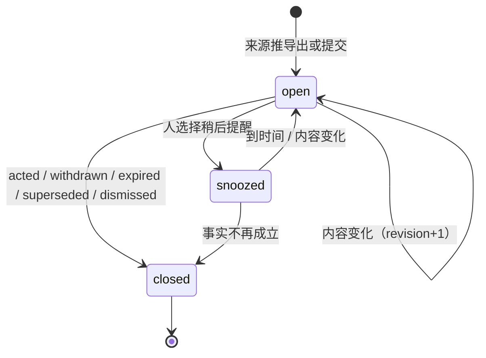

# 001 领域模型

本篇定义收件箱的概念和每个概念遵守的规则。代码、API、界面和后续文档只用这里的术语。依照 [000](000-principles.md) 的"概念少"原则，新的需求先尝试作为已有概念的一个属性，不够再考虑新增概念。

## 概念

| 概念 | 定义 | 遵守的规则 |
|---|---|---|
| **Obligation（义务）** | 一件此刻必须由人处理、否则某项工作无法继续或无法交付的事项 | 只问一件具体的事；有明确的关闭条件；由来源负责撤回 |
| **Subject（主体）** | 义务挂在谁身上，`{ type, ref }`。内置类型：`session`、`system` | 主体类型由插件注册，注册方负责渲染和跳转；收件箱本身不理解主体的业务含义 |
| **Kind（类型）** | 义务的种类，决定分组、默认排序和可用的处理动作 | 每个类型属于一个阻塞等级（见下文）；类型可以由插件注册 |
| **Producer（来源）** | 产生义务的模块 | 推导型来源从事实中算出义务；提交型来源调用 `raise` 和 `withdraw`。两种都必须保证：事实不再成立时义务关闭 |
| **Action（动作）** | 处理义务的一个操作，例如"允许一次""回答""打开" | 动作在能力实际所在的一侧执行（Host 或 Client）；执行完以事实变化为准，而不是以"按钮按过了"为准 |
| **Disposition（处置）** | 人对义务的处置：`seen`（已看）、`snoozed(until)`（稍后提醒）、`dismissed`（忽略） | 只有收件箱本身保存这个状态；不影响主体本身 |
| **Resolution（结局）** | 义务关闭的原因：`acted`（已处理）、`withdrawn`（来源撤回）、`expired`（已过期）、`superseded`（被替代）、`dismissed`（被忽略） | 每个关闭的义务都会写一条账本记录 |
| **Ledger（账本）** | 每个义务从出现到关闭的记录 | 只追加，保存在本地；用于度量，不做权限判断依据 |

人不是领域概念（D1：v1 只有一个人）。义务预留一个可选字段 `audience`，后续团队插件可以用，v1 忽略它。

## 义务的字段

```ts
interface Obligation {
  key: string            // 稳定标识，`${producer}:${subject.type}:${subject.ref}:${localId}`，用于幂等和去重
  revision: number       // 同一个 key 的内容每变化一次就加 1
  producer: string       // 来源插件 id
  subject: { type: string; ref: string }
  kind: string           // 见"内置类型"
  blocking: 'hard' | 'soft' | 'system'
  title: string          // 一句话：在等你做什么
  detail?: string        // 可选：Markdown，折叠显示
  options?: { id: string; label: string; recommended?: boolean }[]  // 可以直接在收件箱里选的选项
  actions: string[]      // 可用的动作 id
  openedAt: string       // 义务出现的时间（事实发生时间，不是插件看到它的时间）
  deadline?: string      // 过了这个时间来源会采取默认行为或义务失效
  certainty: 'exact' | 'inferred'  // 推导是否基于确定的事实
  audience?: string      // 预留，v1 不使用
}
```

## 内置类型和阻塞等级

| 阻塞等级 | 含义 | 内置类型 |
|---|---|---|
| `system` | 不处理的话，**所有** Session 都无法工作 | `credential`（登录失效、需要授权） |
| `hard` | 一个 agent 停下来在等你，什么都不能做 | `approval`（审批）、`question`（提问）、`plan-review`（计划审批） |
| `soft` | 工作已经停下或已经产出，等你决定下一步 | `goal-blocked`（goal 受阻）、`turn-failed`（轮次失败）、`review`（自主运行的产出待验收） |

每种类型由哪些事实推导出来，见 [002](002-builtin-producers.md)。

## 生命周期



规则：

1. **事实优先**。只要事实不再成立（审批已有结果、问题已经回答、goal 已经恢复），义务立即以 `withdrawn` 或 `acted` 关闭，不管人在收件箱里有没有操作过。
2. **在收件箱里操作只是请求**。点"允许一次"之后，直到事实真的变化（`approval/decided` 写入日志）才算关闭；如果失败，条目保持打开并显示错误。
3. **替代**：同一个主体上出现同一类型的新义务时（例如同一个 Session 的新问题），旧义务以 `superseded` 关闭。
4. **忽略需要有边界**。`dismissed` 只对当前 revision 生效；内容变了会重新出现。对硬阻塞类型的"忽略"会提示后果（agent 会一直等）。
5. **稍后提醒**在到期或内容变化时重新出现，并保留原来的 `openedAt`，排序不会因此往后靠。

## 漏斗

漏斗分层把原始事件收敛成条目，每一层只做一件事。

| 层 | 做什么 | v1 规则 |
|---|---|---|
| L0 原始事实 | Session 事件、Host 事件、外部 `raise` | 全部接收 |
| L1 分类 | 这件事需要人吗？ | 确定性规则（见 [002](002-builtin-producers.md)）：进度、轮内工具报错、仍在自动重试的模型错误、用户自己打断的轮次 → 丢弃 |
| L2 合并 | 同一件事只出现一次 | 按 `key` 幂等；同主体同类型只保留最新一条；一个 Session 的多个问题合并成一个条目，按顺序展示 |
| L3 人的处置 | 人已经表达过的意愿 | 忽略、稍后提醒、静音规则（"这个 Workspace 的 `review` 不用提醒"） |
| L4 呈现 | 显示什么、计数多少 | 计数 = 列表长度；健康状态不占空间 |

在 L1 和 L2 被丢弃或合并的事件**只计数，不显示**，用于页脚的"今日已替你挡掉 N 条"和账本里的降噪统计。

## 排序

排序完全确定，不用模型打分：

1. 阻塞等级：`system` > `hard` > `soft`
2. 同一等级内按类型：`approval` > `plan-review` > `question` > `goal-blocked` > `turn-failed` > `review`。审批排第一，是因为它只在当前打开的轮次里有效，而且卡在一个工具动作的中间。注意这和原生侧栏不同：原生的每个 Session 行只显示一种交互，优先级是 plan-review(2) > question(1) > approval(0)（`dsh-client-ui-user-questions`、`dsh-client-ui-approval`）。收件箱把每个交互都列成单独的条目，所以不需要在同一个 Session 内部做取舍，只需要决定全局顺序。
3. 有 `deadline` 的排在前面，越早到期越靠前
4. `openedAt` 早的排在前面：等得越久越靠前

## 计数（诚实计数）

- 侧栏徽标 = `system` + `hard` 类型的打开义务数。`soft` 类型不进徽标，只在页面里显示，否则徽标会一直亮着，失去意义。
- 页面里每个分组标题上的数字 = 该分组列表的长度。
- 稍后提醒和已忽略的义务不计入任何数字。

## 被否决的设计

| 否决 | 理由 |
|---|---|
| 另存一份推导出来的义务 | 违反 P5；推导出的义务只存在内存和可重建的投影里 |
| 每个事件都发通知 | 违反 P4；推送是 Channel 插件的事，并且只推 `system` 和 `hard` |
| 让模型给义务打优先级 | 不可预测、要花 token，而且会变成"廉价而不可靠的信号被放大"（文章第 2 节） |
| 把"一个 Session 运行结束"本身当成义务 | 太吵；只有**自主运行**（goal 续轮、schedule、队友消息唤醒）结束才算 `review`，见 [002](002-builtin-producers.md) |
| 从 agent 的自然语言输出里推断"它在等人" | 原型也否决了这一点：需要结构化的事实，而不是解析文本 |
| v1 给人建模（owner、assignee） | D1；预留 `audience` 字段 |
