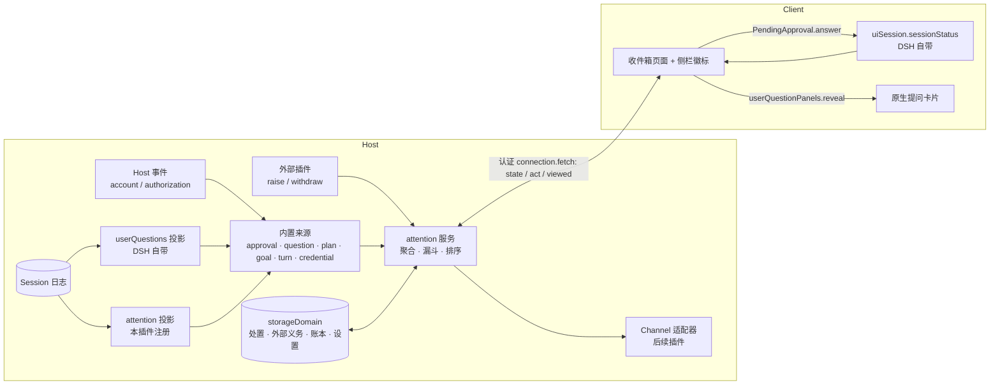

# 003 架构

本篇说明插件由哪些部分组成、各种状态存在哪里，以及原地处理怎样落到 DSH 现有的服务上。概念见 [001](001-domain.md)，推导规则见 [002](002-builtin-producers.md)。[008 验收证据](008-acceptance.md) 保存 [006 原验收标准](006-roadmap.md)，下列已验证结论不等于真实 GUI、市集安装或全部 M0 通过。

## M0 技术结论与证据层次

| Spike | 当前实现选择 | 最小证据与未完成部分 |
|---|---|---|
| S0 | Host 用 `connection.fetch.register` 声明 `/api/attention-inbox`，Client 使用现有认证连接的 fetch 调用；没有把自定义 Remote 反射可用性当作既成事实 | 实际 Cordis route 测试与 Client 注入调用测试；当前真实页面认证调用仍由 lead 验收。与原文 webServer.register 退路的差异明确记录在 [008](008-acceptance.md)。 |
| S1 | Client 保留原生 pendingInteraction 引用，仅 answerable 时调用 PendingApproval.answer | VM 注入集成已验证拒绝/允许/失败保留/迟到响应；未打开 Session 的真实对象和 composer 同步待真实 GUI。 |
| S2 | 原生 PendingQuestion.answer、计时 engage 和 plan intent.approve 是动作来源；无能力则 reveal/review/open 原生交互 | 注入集成覆盖作答、失败和计划 intent，真实 open/continued/多选/计时状态仍待 GUI。 |
| S3 | 本插件投影注册 wire；Host 复用 userQuestions，冷查询通过 sessionQuery observation.projections | 实际 ProjectionRegistry 的真实匿名录制逐 prefix 与 checkpoint/tail 恢复已通过；原生问题 cache 冷读取独立验收仍缺。 |
| S4 | 仅明确自主 source 完成轮才可 review，人工输入和未知来源不能凭完成状态推断自主；取消和恢复失败分别处理 | 3 个授权 Session 的真实结构录制，加原生 AgentLoop/goal driver 固定模型受控录制；aborted/interrupted 语义有源码证据但无真实录制。hash 与边界见 [008](008-acceptance.md)。 |
| S5 | 使用现有 Session 打开能力；特定轮次/工具调用与 composer 预填不作为已交付承诺 | 源码调用与受控测试只能证明调用形态，准确落点和预填的真实 GUI 仍待。 |
| S6 | 只写自有 `attention_inbox` storage domain，不把派生事实写回 Session | 事务失败不确认、持久化和关闭有受控测试；实际路径、完整卸载前后 Session/preset 对照仍由 lead 补证。 |
| S7 | bundle 同时声明 Host patch、Client module 与资源 | 当前 profile 的既往安装/Slot 记录不能替代全新市集安装；60 秒真实义务、零配置、卸载对照见 [008](008-acceptance.md) 待补项。 |

## 总览



## 状态存在哪里（单一事实来源）

| 状态 | 唯一权威 | 本插件怎么用 |
|---|---|---|
| 审批是否在等待 | Session 日志中的 `approval/asked` / `approval/decided` | 由 `attention` 投影读取；不另存 |
| 问题是否在等待 | DSH 的 `userQuestions` 投影 | 直接读取；不另存 |
| goal 的状态 | Session 日志中的 `goal/change` | 由 `attention` 投影读取 |
| 轮次如何结束、由谁触发 | `turn/start`、`turn/end`、`user/message` | 由 `attention` 投影读取 |
| 账户和凭据 | `deepseekAccount`、`authorization` 服务 | 订阅事件，状态只放内存 |
| 浏览器此刻的待处理交互对象 | Client `uiSession` | 只用于执行动作，不作为义务存在与否的依据 |
| 人的处置（已看、稍后提醒、忽略、静音规则） | **本插件** storageDomain | 自有数据 |
| 外部插件提交的义务 | **本插件** storageDomain | 自有数据；由提交方负责撤回 |
| 账本 | **本插件** storageDomain | 只追加；默认保留 90 天 |

推导出来的义务只存在于内存，每次启动都重新推导。删除插件的全部存储，只会丢掉处置和账本，任何 Session 都不受影响。

## Host 部分

### `attention` 投影（每个 Session 一份）

在 `sessionProjections` 上注册一个投影单元（`dsh-session-projection` 的 `ProjectionDefinition`）：

```ts
interface AttentionSessionState {
  approvals: { requestId: string; toolName: string; callId?: string; reason?: string; askedAt: string }[]
  goal?: { id: string; phase: 'active' | 'paused' | 'blocked' | 'complete'; objective: string; reason?: string; rounds?: [number, number]; at: string }
  turn?: { open: boolean; trigger: 'human' | 'goal' | 'schedule' | 'team' | 'wake' | 'unknown'; endReason?: string; endedAt?: string; error?: string }
}
```

- `apply` 只处理 `approval/*`、`goal/change`、`turn/start`、`turn/end`、`user/message` 这几种事件；其余事件原样返回同一个引用，下游零开销（这是投影契约的要求）。
- 提供一个精简的 `wire` 视图（只包括 goal 和最后一轮的摘要）。这样 DSH 的 `session-projection-cache` 会把它写入检查点，Session 不在内存里时也能零 I/O 读到，用于冷启动回填。审批不进 `wire`，因为它只在打开的轮次里有意义。
- `stateVersion` 从 1 开始，字段或推导语义一改就加 1。

### 内置来源

每个来源都是一个独立的内部插件，**只通过公开的 `attention` API 工作**（P7）：

| 来源 | 输入 | 产出类型 |
|---|---|---|
| `producer-approval` | `attention` 投影中的 approvals | `approval` |
| `producer-questions` | `userQuestions` 投影 | `question`、`plan-review` |
| `producer-goal` | `attention` 投影中的 goal | `goal-blocked`、`review`（goal 已完成） |
| `producer-turn` | `attention` 投影中的 turn，加上 Client 上报的主视图状态 | `review`、`turn-failed` |
| `producer-account` | `deepseek-account/*`、`authorization/settled` | `credential` |

推导型来源实现 `derive(sessionId, state) → Obligation[]`，由服务在投影变化时调用，服务据此做差异比较，自动完成打开、更新和撤回。来源不需要自己记住发出过哪些义务。

### `attention` 服务

职责：

1. 维护注册表：来源、主体类型、类型、动作、Channel、漏斗规则（契约见 [004](004-extension-api.md)）。
2. 聚合：推导出的义务 + 外部提交的义务 → 经过漏斗 L2、L3 → 排好序的视图。
3. 写账本：义务关闭时写一条记录。
4. 通过认证 `connection.fetch` 路由对 Client 提供操作；Host API 另有 `watch()` 异步迭代：
   - `state`：返回完整视图、分组计数和可核实账本/漏斗指标；
   - `act`：执行已注册 Host 动作；原生审批/问题的作答仍调用 Client 原生对象；
   - `dispose`：忽略、稍后提醒；
   - `viewed`/视图状态上报：记录查看处置，并提供当前主视图事实，供 review 抑制使用。
5. 发出 Host 事件：`attention/opened`、`attention/updated`、`attention/closed`。

聚合的刷新做 100 ms 节流，避免一轮里大量事件导致反复推送。

### 冷启动回填

启动时（以及装上插件时）运行一次，并发数受限：

1. `sessionQuery.listSessions()` 列出最近 7 天、持久化、但不在内存中的 Session；
2. 优先读 `session-projection-cache` 的检查点（`attention` 和 `userQuestions` 的 wire 值）；
3. 没有检查点的，才用 `sessionQuery` 读日志重新推导；
4. 只保留 [002](002-builtin-producers.md) 中"历史回填"一节列出的类型。

## Client 部分

| 部件 | 挂载位置 | 说明 |
|---|---|---|
| 入口图标 + 徽标 | `sidebar.panellist` | 徽标数 = `system` + `hard` 类型的打开义务数；为 0 时不显示 |
| 收件箱页面 | `main`（key：`attention`） | 见 [005](005-ux.md) |
| 主体渲染扩展点 | 本插件声明的 keyed slot `attention.subject`（按主体类型选择） | 后续插件给自己的主体类型注册渲染组件 |
| 主视图上报 | 订阅 `uiSession` / Session 列表的 `retainedBy.mainView` | 节流后调用 `markViewed` |

v1 **不**在 Session 内部（composer、header）加任何东西，因为原生 UI 已经处理了当前 Session 里的交互，再加就是重复。

## 原地处理：动作在哪一侧执行

| 动作 | 执行侧 | 实现 | 条件 |
|---|---|---|---|
| 审批：允许一次 / 拒绝 | Client | 在 `uiSession.sessionStatus` 里找到对应 Session 的 `pendingInteraction`，`kind === 'approval'` 且 `answerable` 时调用 `answer(...)` | 当前浏览器已经收到这个审批请求；否则退回"打开 Session" |
| 回答 continued 状态的问题 | Host | `userQuestions.answer(agent, callId, answer)`；Session 已关闭时 DSH 会先恢复它 | 无 |
| 回答阻塞中的问题 | Client | `userQuestionPanels.reveal(sessionId, callId)` 打开原生卡片 | 无 |
| 批准计划 | Client | 和阻塞中的问题一样，使用 intent 里的 `approve` 选项；v1 先用 `review` 打开原生审阅界面 | 见 spike S2 |
| 打开 Session / 跳到某一轮 | Client | 在 `main` 切到 conversation 并选中 Session | 见 spike S5 |
| 忽略 / 稍后提醒 / 静音 | Host | 写入 storageDomain | 无 |

**动作执行成功不等于义务关闭**：只有对应的事实发生变化（例如 `approval/decided` 已写入日志）时，义务才关闭（[001](001-domain.md) 规则 2）。在那之前，条目显示"处理中"，超过 5 秒没变化就显示错误，并提供"打开 Session"。

**安全边界**：收件箱能做的事不超过原生 UI。它只调用原生 UI 用的同一套能力，不新增"总是允许"之类的权限，不做任何自动批准。从收件箱完成的审批会在账本里记 `via: 'inbox'`。

## 降级

| 情形 | 表现 |
|---|---|
| 没有浏览器连接 | Host 照常收集义务；Channel 插件仍然能拿到；审批无法从收件箱处理 |
| Headless profile（没有 Client） | 只有 Host 服务，供其他插件使用 |
| 某个依赖的服务不存在（例如 `goals` 没有加载） | 对应的来源不启用，其余来源正常工作；设置页说明缺了哪个来源 |
| 冷启动回填失败 | 记一条警告，只显示实时义务，不阻塞启动 |

## 包结构

当前实现直接分发 ESM JavaScript，公开类型通过声明文件提供；早期 `src/*.ts`/tsdown/vitest 是原型设想。

```
dsh-inbox/
├─ package.json            # dsh.bundle / dsh.client 与 api 类型入口
├─ cordis.patch.yml        # Host 行；没有必填配置
├─ index.js                # Host 装配、原生投影和只读冷回填
├─ client.js               # Client 入口、页面、原生动作适配
├─ lib/
│  ├─ core.js              # 排序、计数、规范化与差异比较
│  ├─ projection.js        # Session 结构事件增量投影及 wire
│  ├─ service.js           # 账本、外部提交、动作与持久化
│  └─ api.d.ts             # 导出的扩展契约
├─ icon.svg
├─ locale/{zh,en}.json
├─ examples/hello-producer/# 按需接入真实 caller 的简短扩展示例
├─ scripts/acceptance*.mjs # 隔离录制与匿名证据处理
├─ tests/                  # Node test、真实 runtime 回放、扩展类型编译
│  └─ fixtures/            # 匿名结构录制、来源与 SHA-256
└─ docs/
```

检查使用 Node 的 `--check`/`--test`。实际 Cordis、SessionStore、ProjectionRegistry 测试通过 `DSH_TEST_RUNTIME` 指向已有 DSH runtime；TypeScript 5.9.3 用于公开扩展契约的真实类型编译。运行结果与未覆盖边界见 [008](008-acceptance.md)。
